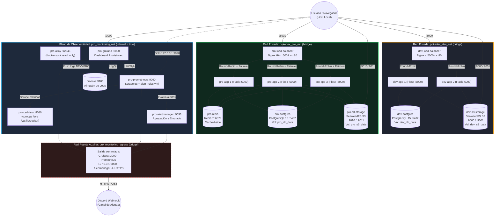
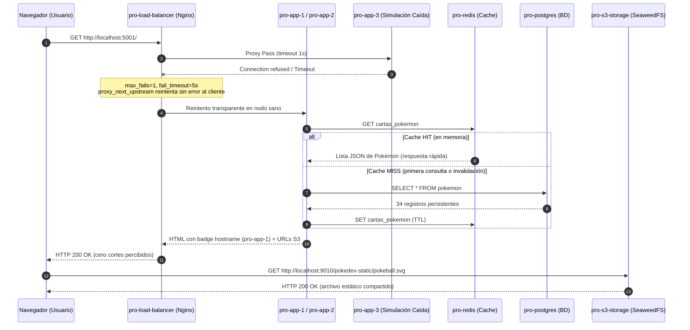
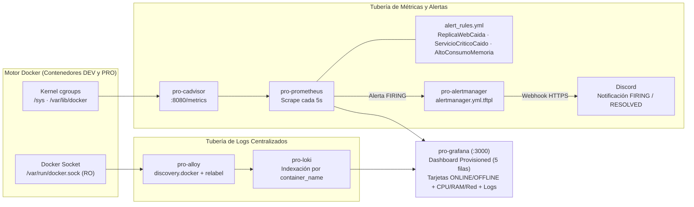
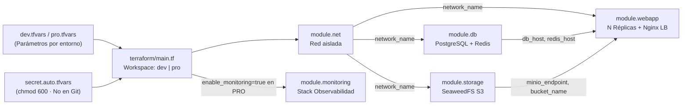

# Pokédex Cloud — Infraestructura como Código con Terraform y Docker


> **Práctica 2 — Infraestructura como Código (IaC): Terraform**  
> Universitat de les Illes Balears (UIB) · Despliegue multi-entorno simulado en cloud mediante el provider `kreuzwerker/docker`.

---

## Tabla de Contenidos

1. [Descripción General](#1-descripción-general)
2. [Arquitectura del Sistema y Diagramas](#2-arquitectura-del-sistema-y-diagramas)
3. [Comparativa de Entornos (DEV vs. PRO) y Mapa de Puertos](#3-comparativa-de-entornos-dev-vs-pro-y-mapa-de-puertos)
4. [Estructura del Proyecto y Modularización IaC](#4-estructura-del-proyecto-y-modularización-iac)
5. [Decisiones Técnicas y Seguridad por Diseño](#5-decisiones-técnicas-y-seguridad-por-diseño)
6. [Observabilidad: Métricas, Logs Centralizados y Alertas](#6-observabilidad-métricas-logs-centralizados-y-alertas)
7. [Guía de Setup, Despliegue y Demo Guiada](#7-guía-de-setup-despliegue-y-demo-guiada)
8. [Tests Utilizados y Outputs Reales](#8-tests-utilizados-y-outputs-reales)
9. [Declaración de Uso de Inteligencia Artificial (Gemini — Neon)](#9-declaración-de-uso-de-inteligencia-artificial-gemini--neon)

---

## 1. Descripción General

**Pokédex Cloud** migra y evoluciona una aplicación web en Flask hacia una arquitectura **100 % declarativa e idempotente con Terraform**, simulando un despliegue profesional en la nube sobre contenedores Docker.

El proyecto permite levantar **simultáneamente los entornos de Desarrollo (`dev`) y Producción (`pro`)** sin colisiones de nombres, puertos ni redes, cumpliendo todos los requisitos de alta disponibilidad, almacenamiento de objetos S3, caché distribuida, observabilidad completa y seguridad de red:

- **Infraestructura modular:** 5 módulos reutilizables con estructura estándar HashiCorp de 4 archivos (`versions.tf`, `variables.tf`, `main.tf`, `outputs.tf`).
- **Balanceo de carga dinámico con Nginx:** Configuración generada al vuelo mediante `templatefile` + `local_file` y reemplazo automático ante escalado horizontal (`replace_triggered_by`), distribuyendo tráfico en **Round-Robin** con *failover* automático.
- **Identificación de réplica en vivo:** Cada contenedor Flask muestra su `hostname` (`dev-app-1..2` / `pro-app-1..3`) y estado en tiempo real de sus dependencias (`/status`) directamente en la UI.
- **Persistencia y Caché:** PostgreSQL 15 con volúmenes persistentes e inicialización automática (`init.sql`) en ambos entornos, y Redis 7 condicional desplegado exclusivamente en `pro`.
- **Almacenamiento S3 compartido:** SeaweedFS compatible con AWS S3 para desacoplar archivos estáticos y sprites de las réplicas *stateless*.
- **Observabilidad centralizada y segura:** Stack completo (`cAdvisor` + `Prometheus` + `Grafana` + `Loki` + `Grafana Alloy` + `Alertmanager` -> `Discord`) desplegado en una red interna aislada (`internal = true`) monitorizando simultáneamente `dev` y `pro`.

---

## 2. Arquitectura del Sistema y Diagramas

### 2.1 Topología Multi-Entorno y Segmentación de Redes



### 2.2 Flujo de Peticiones, Cache-Aside y Failover en PRO



### 2.3 Pipeline de Observabilidad, Logs y Alertas



---

## 3. Comparativa de Entornos (DEV vs. PRO) y Mapa de Puertos

### 3.1 Diferencias parametrizadas por `.tfvars`

Un único código base en `terraform/` despliega ambos entornos de forma independiente gracias a los **Workspaces de Terraform** (`dev` y `pro`) y sus respectivos ficheros de variables:

| Parámetro / Característica | Desarrollo (`dev.tfvars`) | Producción (`pro.tfvars`) |
| :--- | :---: | :---: |
| **Workspace Terraform** | `dev` | `pro` |
| **Red de aplicación aislada** | `pokedex_dev_net` | `pokedex_pro_net` |
| **Puerto web (Nginx LB)** | `5000` (`http://localhost:5000`) | `5001` (`http://localhost:5001`) |
| **Réplicas Flask (`app_replicas`)** | `2` (`dev-app-1`, `dev-app-2`) | `3` (`pro-app-1`, `pro-app-2`, `pro-app-3`) |
| **Política de balanceo** | Round-Robin dinámico | Round-Robin dinámico + Failover HA |
| **Base de Datos PostgreSQL** | `dev-postgres` (`dev_db_data`) | `pro-postgres` (`pro_db_data`) |
| **Servicio de Caché Redis (`enable_redis`)** | `false` (Desactivado) | `true` (`pro-redis`, activo) |
| **Almacenamiento S3 SeaweedFS** | `9000` (API) / `9001` (Consola) | `9010` (API) / `9011` (Consola) |
| **Stack de Monitorización (`enable_monitoring`)** | `false` *(monitorizado desde PRO)* | `true` *(centralizado para DEV y PRO)* |
| **Alertas automáticas (Discord)** | N/A | Activas (Alertmanager + Webhook) |
| **Total de contenedores activos** | **5 contenedores** | **13 contenedores** *(18 en total simultáneos)* |

### 3.2 Mapa Completo de Puertos y Exposición

Se aplica el **principio de mínimo privilegio**: ningún motor de base de datos, caché, réplica Flask ni servicio interno de recolección expone puertos hacia el host.

| Contenedor | Entorno | Puerto Host (`external`) | Puerto Interno (`internal`) | Interfaz Bind | Acceso Permitido |
| :--- | :---: | :---: | :---: | :---: | :--- |
| `dev-load-balancer` | DEV | `5000` | `80` | `0.0.0.0` | Navegador / Cliente HTTP |
| `pro-load-balancer` | PRO | `5001` | `80` | `0.0.0.0` | Navegador / Cliente HTTP |
| `dev-s3-storage` | DEV | `9000` / `9001` | `9000` / `8888` | `0.0.0.0` | Descarga estáticos S3 / Consola Filer |
| `pro-s3-storage` | PRO | `9010` / `9011` | `9000` / `8888` | `0.0.0.0` | Descarga estáticos S3 / Consola Filer |
| `pro-grafana` | PRO | `3000` | `3000` | `0.0.0.0` | Interfaz visual autenticada (`admin`) |
| `pro-prometheus` | PRO | **`9090`** | `9090` | **`127.0.0.1`** | **Solo loopback local** (bloqueado desde red y apps) |
| `dev-app-1..2` / `pro-app-1..3` | DEV/PRO | *Cerrado* | `5000` | Solo red interna | Únicamente desde su Nginx LB |
| `dev-postgres` / `pro-postgres` | DEV/PRO | *Cerrado* | `5432` | Solo red interna | Únicamente desde sus réplicas Flask |
| `pro-redis` | PRO | *Cerrado* | `6379` | Solo red interna | Únicamente desde `pro-app-*` |
| `pro-cadvisor` | PRO | *Cerrado* | `8080` | `pro_monitoring_net` | Únicamente desde `pro-prometheus` |
| `pro-loki` | PRO | *Cerrado* | `3100` | `pro_monitoring_net` | Únicamente desde `pro-alloy` y `pro-grafana` |
| `pro-alloy` | PRO | *Cerrado* | `12345` | `pro_monitoring_net` | Recolección local hacia `pro-loki` |
| `pro-alertmanager` | PRO | *Cerrado* | `9093` | `pro_monitoring_net` + egress | Recibe de Prometheus y sale a Discord HTTPS |

---

## 4. Estructura del Proyecto y Modularización IaC

### 4.1 Árbol de Directorios

```text
practica2-terraform/
├── Makefile                                  # Automatización de despliegues, planes y limpieza
├── demo.sh                                   # Script interactivo guiado para la defensa (13 pasos)
├── init.sql                                  # Esquema y carga inicial de 34 Pokémon en PostgreSQL
├── .gitignore                                # Excluye estados, .terraform/ y secret.auto.tfvars
├── README.md                                 # Documentación técnica y guía de uso
│
├── app/                                      # Aplicación Web Flask (stateless)
│   ├── Dockerfile                            # Imagen Python 3.11-slim (usuario no-root appuser)
│   ├── requirements.txt                      # Dependencias (Flask, psycopg2, redis, boto3, etc.)
│   ├── app.py                                # Lógica web, caché, S3 y endpoint /status
│   └── templates/                            # UI con badges en vivo e identificador de réplica
│
├── config/                                   # Configuración desacoplada de servicios (montada RO)
│   ├── nginx/
│   │   └── lb.conf.tftpl                     # Plantilla dinámica Round-Robin + Failover HA
│   ├── prometheus/
│   │   ├── prometheus.yml                    # Scrape jobs (cAdvisor cada 5s) y conexión Alertmanager
│   │   └── alert_rules.yml                   # Reglas PromQL de alertas críticas y de memoria
│   ├── alertmanager/
│   │   └── alertmanager.yml.tftpl            # Plantilla de enrutado hacia Webhook de Discord
│   ├── alloy/
│   │   └── config.alloy                      # Pipeline River/HCL de docker.sock hacia Loki
│   ├── loki/
│   │   └── loki-config.yml                   # Configuración del almacén local de logs
│   └── grafana/
│       ├── provisioning/
│       │   ├── datasources/                  # Autoconfiguración de Prometheus y Loki al arrancar
│       │   └── dashboards/                   # Registro automático de dashboards JSON
│       └── dashboards/
│           └── pokedex_dashboard.json        # Dashboard integral de 5 filas (schemaVersion 39)
│
└── terraform/                                # Código de Infraestructura como Código (IaC)
    ├── main.tf                               # Orquestador raíz que invoca los 5 módulos
    ├── variables.tf                          # Declaración de variables de entrada de la raíz
    ├── outputs.tf                            # URLs de acceso mostradas al finalizar apply
    ├── dev.tfvars                            # Parámetros específicos de Desarrollo
    ├── pro.tfvars                            # Parámetros específicos de Producción
    ├── secret.auto.tfvars                    # [LOCAL / IGNORADO POR GIT] Contraseñas y Webhook
    └── modules/                              # Módulos reutilizables (4 archivos estándar c/u)
        ├── network/      (versions.tf, variables.tf, main.tf, outputs.tf)
        ├── database/     (versions.tf, variables.tf, main.tf, outputs.tf)
        ├── storage/      (versions.tf, variables.tf, main.tf, outputs.tf)
        ├── webapp/       (versions.tf, variables.tf, main.tf, outputs.tf)
        └── monitoring/   (versions.tf, variables.tf, main.tf, outputs.tf)
```

### 4.2 Flujo de Variables y Módulos en Terraform



### 4.3 Responsabilidad de cada Módulo

Todos los módulos cumplen la convención oficial de HashiCorp de **4 archivos** (`versions.tf` fijando `kreuzwerker/docker ~> 3.0.2`, `variables.tf` con tipos y marca `sensitive = true` en secretos, `main.tf` con recursos y `outputs.tf` con salidas explícitas):

| Módulo | Recursos Creados | Salidas (`outputs.tf`) |
| :--- | :--- | :--- |
| **`network`** | `docker_network.net` (`pokedex_<env>_net`) | `network_name` |
| **`database`** | `docker_volume.db_data`, `postgres:15-alpine` (con `init.sql` y healthcheck `pg_isready`), `redis:7-alpine` condicional (`count`) | `db_host`, `redis_host` |
| **`storage`** | `docker_volume.minio_data`, `chrislusf/seaweedfs:latest` (API S3 + Filer UI) | `minio_endpoint`, `bucket_name` |
| **`webapp`** | Build `pokedex-app:<env>` (con trigger SHA1 del directorio `app/`), `N` réplicas `app_replicas` (`count`), `local_file.nginx_conf` (`templatefile`), `load_balancer` (Nginx con `replace_triggered_by`) | `load_balancer_url`, `replica_names` |
| **`monitoring`** | Redes `pro_monitoring_net` (`internal = true`) y `pro_monitoring_egress`, `cadvisor`, `prometheus`, `loki`, `alloy`, `grafana`, `local_file.alertmanager_conf` y `alertmanager` (condicionales con `count`) | `monitoring_network`, `grafana_url`, `prometheus_url` |

---

## 5. Decisiones Técnicas y Seguridad por Diseño

### 5.1 Balanceador Dinámico y Argumentación de Política Round-Robin

- **¿Por qué Round-Robin?** Las peticiones de la aplicación Pokédex en Flask son **stateless, breves y de coste computacional homogéneo** (consultas rápidas a Redis/PostgreSQL y renderizado ligero de plantillas). Round-Robin distribuye el tráfico de forma estrictamente equitativa con sobrecarga mínima. Algoritmos como `least_conn` aportan valor en conexiones persistentes o de duración muy desigual (WebSockets, streaming), y `ip_hash` rompería el balanceo al concentrar todas las pruebas desde la misma IP local.
- **Generación dinámica sin IPs hardcodeadas:** `local_file.nginx_conf` renderiza `config/nginx/lb.conf.tftpl` pasándole `docker_container.app_replicas[*].name`. El DNS interno de Docker (`127.0.0.11`) resuelve automáticamente la IP real de cada contenedor aunque se recree.
- **Recarga automática al escalar:** Debido a que el montaje de un archivo individual en Docker se enlaza por *inode*, `docker_container.load_balancer` incorpora:
  ```hcl
  lifecycle {
    replace_triggered_by = [
      local_file.nginx_conf
    ]
  }
  ```
  Al escalar (ej. de 3 a 4 réplicas), Terraform actualiza `nginx_pro.conf` y reemplaza el contenedor Nginx automáticamente para aplicar el nuevo bloque `upstream` sin intervención manual.

### 5.2 Alta Disponibilidad (HA) sin Cortes

En `config/nginx/lb.conf.tftpl` se ajustaron los tiempos de detección y reintento pasivo para eliminar los 60 segundos de espera por defecto de Nginx:

```nginx
upstream backend_nodes {
    %{ for name in backend_names ~}
    server ${name}:5000 max_fails=1 fail_timeout=5s;
    %{ endfor ~}
}

location / {
    proxy_pass http://backend_nodes;
    proxy_connect_timeout 1s;
    proxy_read_timeout 5s;
    proxy_next_upstream error timeout http_502 http_503 http_504;
    proxy_next_upstream_tries 3;
}
```

Si una réplica deja de responder, Nginx aborta el intento en `1s`, **reintenta esa misma petición en otro nodo sano** (el usuario recibe `HTTP 200 OK` sin errores) y aparta temporalmente el nodo fallido. Además, todos los contenedores utilizan `restart = "unless-stopped"` para auto-recuperarse ante fallos inesperados del proceso.

### 5.3 Idempotencia Real en Terraform

El proveedor `kreuzwerker/docker` puede generar falsos reemplazos en planes sucesivos (`network_mode = "bridge" -> null`) cuando se usa `networks_advanced`. Para garantizar **idempotencia estricta** (`No changes. Your infrastructure matches the configuration.`):
1. Se declara explícitamente `network_mode = "bridge"` en todos los recursos `docker_container`.
2. Se establece `keep_locally = true` en todas las imágenes base para evitar descargas repetidas tras `destroy`.
3. La reconstrucción de la imagen de Flask solo se dispara cuando cambia el hash SHA-1 del contenido de `app/`.

### 5.4 Seguridad y Aislamiento de Redes

- **Modelo híbrido de observabilidad:** Todos los componentes de monitorización se comunican exclusivamente a través de `pro_monitoring_net` con **`internal = true`**. Ningún contenedor de aplicación (`dev-app-*`, `pro-app-*`, `postgres`, `redis`) puede resolver ni alcanzar Prometheus, Loki, cAdvisor o Alertmanager.
- **Prometheus protegido por loopback:** Como Prometheus no dispone de autenticación nativa, su puerto se vincula estrictamente a `ip = "127.0.0.1"` (`127.0.0.1:9090`), bloqueando accesos desde cualquier otro equipo de la red local mientras permanece accesible en el host para depuración y defensa.
- **Gestión de secretos:** Todas las contraseñas (`db_password`, `minio_password`) y la URL del Webhook de Discord residen en `terraform/secret.auto.tfvars` con permisos `0600` y exclusión estricta en `.gitignore`. En el módulo `monitoring`, el archivo generado `alertmanager_pro.yml` se guarda en `terraform/.terraform/` (ignorado por Git) con permisos `0644` para permitir lectura al usuario sin privilegios `nobody` dentro del contenedor de Alertmanager.

---

## 6. Observabilidad: Métricas, Logs Centralizados y Alertas

### 6.1 Dashboard Integral de Grafana (`config/grafana/dashboards/pokedex_dashboard.json`)

Grafana se aprovisiona íntegramente como código (*Provisioning IaC*) al arrancar (`datasources` + `dashboards`), presentando un panel de **5 filas temáticas** (`http://localhost:3000/d/pokedex-obs`, refresco automático cada `5s`):

| Fila | Paneles Incluidos | Qué Permite Verificar |
| :---: | :--- | :--- |
| **1** | **Resumen Ejecutivo (KPIs)** | Contenedores activos totales, réplicas `pro-app` activas (umbrales rojo/naranja/verde), memoria RAM global (MB) y uso total de CPU (%). |
| **2** | **Estado Individual por Contenedor** | Tarjetas independientes `ONLINE` (verde) / `OFFLINE` (rojo) separadas en **Aplicación y Datos (DEV + PRO)** y **Stack de Observabilidad**. Usa `max by (name)` para evitar tarjetas duplicadas por IDs históricos tras recreaciones. |
| **3** | **CPU (%) y Memoria RAM (MB)** | Series temporales suavizadas por contenedor con leyenda tabular (`last` y `max`) para comparar el consumo real de DEV y PRO. |
| **4** | **Tráfico de Red RX / TX (KB/s)** | Caudal entrante y saliente entre Nginx, Flask, Redis, PostgreSQL y SeaweedFS. |
| **5** | **Consola de Logs Centralizados (Loki)** | Flujo unificado en vivo filtrado con `{container_name=~"(dev|pro)-(app|postgres|redis|load-balancer|s3-storage).*"}`, eliminando el ruido interno de `pro-loki`. |

### 6.2 Reglas de Alerta Configuradas (`config/prometheus/alert_rules.yml`)

Prometheus evalúa estas reglas cada `5s` y envía las alertas activas (`FIRING`) a `pro-alertmanager`, que notifica mediante Webhook al canal de **Discord** (tanto al dispararse como al resolverse `RESOLVED`):

| Alerta | Condición PromQL | Duración (`for`) | Severidad | Descripción |
| :--- | :--- | :---: | :---: | :--- |
| **`ReplicaWebCaida`** | `count(time() - container_last_seen{name=~"pro-app-.*"} < 15) < 3` | `10s` | `critical` | Menos de 3 instancias de Flask activas en PRO. |
| **`ServicioCriticoCaido`** | `absent(time() - container_last_seen{name="pro-postgres"} < 15) or absent(time() - container_last_seen{name="pro-redis"} < 15)` | `10s` | `critical` | Caída de PostgreSQL o Redis en PRO. |
| **`AltoConsumoMemoria`** | `(container_memory_usage_bytes{name=~"pro-.*"} / 1024 / 1024) > 300` | `15s` | `warning` | Un contenedor de PRO supera los 300 MB de RAM. |

---

## 7. Guía de Setup, Despliegue y Demo Guiada

### 7.1 Prerrequisitos

- **Docker Engine** en ejecución (usuario perteneciente al grupo `docker`).
- **Terraform** `>= 1.0.0`.
- **GNU Make**, `curl`, `bash` y `python3` (para los scripts de verificación y demo).

### 7.2 Paso 1 — Clonar el repositorio y configurar secretos

```bash
git clone <URL_DEL_REPOSITORIO_GITHUB>
cd practica2-terraform
```

Crea el fichero de secretos local `terraform/secret.auto.tfvars` (ignorado por Git) y protege sus permisos:

```bash
cat << 'EOF' > terraform/secret.auto.tfvars
db_password         = "TuPasswordSeguraPostgres!"
minio_password      = "TuPasswordSeguraS3!"
discord_webhook_url = "https://discord.com/api/webhooks/<ID>/<TOKEN>"
EOF

chmod 600 terraform/secret.auto.tfvars
```

### 7.3 Paso 2 — Inicializar y desplegar con `Makefile`

```bash
# Inicializar proveedores y workspaces (solo la primera vez)
terraform -chdir=terraform init
terraform -chdir=terraform workspace new dev || true
terraform -chdir=terraform workspace new pro || true

# Desplegar ambos entornos simultáneamente
make deploy-dev
make deploy-pro
```

#### Comandos disponibles en el `Makefile`

| Comando | Acción |
| :--- | :--- |
| `make deploy-dev` / `make deploy-pro` | Selecciona el workspace y aplica el despliegue con su `.tfvars`. |
| `make plan-dev` / `make plan-pro` | Ejecuta `terraform plan` para verificar cambios o idempotencia (`No changes`). |
| `make destroy-dev` / `make destroy-pro` | Destruye los recursos del entorno seleccionado conservando imágenes locales. |
| `make demo` *(opcional)* | Ejecuta la demostración guiada paso a paso (`./demo.sh`). |

### 7.4 Paso 3 — Accesos y Credenciales

| Servicio | URL | Credenciales | Descripción |
| :--- | :--- | :---: | :--- |
| **Pokédex Web (DEV)** | `http://localhost:5000` | — | Balanceador Nginx DEV (2 réplicas, sin Redis) |
| **Pokédex Web (PRO)** | `http://localhost:5001` | — | Balanceador Nginx PRO (3 réplicas + Redis + HA) |
| **Consola S3 (DEV)** | `http://localhost:9001/buckets/pokedex-static/` | — | Explorador de objetos estáticos SeaweedFS DEV |
| **Consola S3 (PRO)** | `http://localhost:9011/buckets/pokedex-static/` | — | Explorador de objetos estáticos SeaweedFS PRO |
| **Grafana** | `http://localhost:3000/d/pokedex-obs` | `admin` / `admin` | Dashboard integral de métricas, estado y logs |
| **Prometheus (Local)** | `http://127.0.0.1:9090` | Solo loopback | Targets (`/targets`) y alertas (`/alerts`) |

### 7.5 Paso 4 — Ejecutar la Demo Interactiva (`demo.sh`)

El repositorio incluye `demo.sh`, un guion interactivo de **13 pasos** con cronómetro de exposición, pausas de interacción, verificación automática de cada requisito y restauración automática (`trap EXIT`) si se interrumpe a mitad:

```bash
chmod +x demo.sh

./demo.sh                  # Demo guiada completa paso a paso (1 ENTER por paso)
./demo.sh --fresh          # Destruye DEV y PRO y los despliega desde cero
./demo.sh --list           # Índice de los 13 pasos con tiempos objetivo
./demo.sh --map            # Mapa requisito del enunciado -> archivo:línea
./demo.sh --access         # Imprime la tabla de URLs y credenciales
./demo.sh --from 4 --to 5  # Ejecuta solo balanceo Round-Robin y escalado 3 -> 4 -> 3
./demo.sh --from 8 --to 12 # Ejecuta solo caída HA, Grafana, alerta Discord y recuperación
./demo.sh --auto           # Ejecución automática sin pausas (verificación completa)
```

---

## 8. Tests Utilizados y Outputs Reales

A continuación se documenta la batería de pruebas ejecutada sobre el entorno desplegado (automatizada también en `demo.sh`):

### Test 1 — Validación Sintáctica e Idempotencia de Terraform

**Comandos:**
```bash
terraform -chdir=terraform validate
make plan-dev
make plan-pro
```

**Output:**
```text
Success! The configuration is valid.

[OK] DEV: No changes (la infraestructura real coincide al 100 % con el código).
[OK] PRO: No changes (la infraestructura real coincide al 100 % con el código).
```

---

### Test 2 — Despliegue Simultáneo de DEV y PRO (18 Contenedores)

**Comando:**
```bash
docker ps --format 'table {{.Names}}\t{{.Status}}\t{{.Ports}}' | awk 'NR==1{print; next} /^(dev|pro)-/{print | "sort"}'
```

**Output:**
```text
NAMES               STATUS                    PORTS
dev-app-1           Up 17 seconds             5000/tcp
dev-app-2           Up 17 seconds             5000/tcp
dev-load-balancer   Up 16 seconds             0.0.0.0:5000->80/tcp
dev-postgres        Up 58 seconds (healthy)   5432/tcp
dev-s3-storage      Up 58 seconds             0.0.0.0:9000->9000/tcp, 0.0.0.0:9001->8888/tcp
pro-alertmanager    Up 8 seconds              9093/tcp
pro-alloy           Up 9 seconds
pro-app-1           Up 8 seconds              5000/tcp
pro-app-2           Up 8 seconds              5000/tcp
pro-app-3           Up 8 seconds              5000/tcp
pro-cadvisor        Up 11 seconds (healthy)
pro-grafana         Up 8 seconds              0.0.0.0:3000->3000/tcp
pro-load-balancer   Up 7 seconds              0.0.0.0:5001->80/tcp
pro-loki            Up 11 seconds
pro-postgres        Up 11 seconds (healthy)   5432/tcp
pro-prometheus      Up 10 seconds             127.0.0.1:9090->9090/tcp
pro-redis           Up 11 seconds (healthy)   6379/tcp
pro-s3-storage      Up 11 seconds             0.0.0.0:9011->8888/tcp, 0.0.0.0:9010->9000/tcp
```

---

### Test 3 — Balanceo Round-Robin y Escalado Dinámico (`3 -> 4 -> 3`)

**Comandos:**
```bash
# Escalado en caliente con sobreescritura temporal de variable
terraform -chdir=terraform workspace select pro
terraform -chdir=terraform apply -auto-approve -var-file=pro.tfvars -var="app_replicas=4"
grep 'server pro-app' terraform/.terraform/nginx_pro.conf
```

**Output:**
```text
# Configuración upstream regenerada automáticamente por local_file + replace_triggered_by:
        server pro-app-1:5000 max_fails=1 fail_timeout=5s;
        server pro-app-2:5000 max_fails=1 fail_timeout=5s;
        server pro-app-3:5000 max_fails=1 fail_timeout=5s;
        server pro-app-4:5000 max_fails=1 fail_timeout=5s;

# Distribución en 12 peticiones consecutivas a http://localhost:5001/:
Resumen: pro-app-1 (3) | pro-app-2 (3) | pro-app-3 (3) | pro-app-4 (3)
```

Al ejecutar de nuevo `make deploy-pro`, Terraform destruye `pro-app-4`, regenera `nginx_pro.conf` con 3 nodos y devuelve el clúster al estado declarado en `pro.tfvars`.

---

### Test 4 — Persistencia PostgreSQL (`init.sql`) y Caché Redis en PRO

**Comandos:**
```bash
docker exec pro-postgres sh -c 'psql -U "$POSTGRES_USER" -d "$POSTGRES_DB" -c "SELECT count(*) AS total_pokemon FROM pokemon;"'
docker exec pro-redis redis-cli ping
docker exec pro-redis redis-cli KEYS '*'
docker exec pro-redis redis-cli INFO stats | grep -E 'keyspace_hits|keyspace_misses'
```

**Output:**
```text
 total_pokemon
---------------
            34
(1 row)

PONG
cartas_pokemon
keyspace_hits:24
keyspace_misses:3
```

---

### Test 5 — Almacenamiento S3 Compartido (SeaweedFS)

**Comandos:**
```bash
docker volume ls --filter 'name=_s3_data'
curl -s -o /dev/null -w '%{http_code}\n' http://localhost:9000/pokedex-static/pokeball.svg
curl -s -o /dev/null -w '%{http_code}\n' http://localhost:9010/pokedex-static/pokeball.svg
```

**Output:**
```text
DRIVER    VOLUME NAME
local     dev_s3_data
local     pro_s3_data

S3 DEV (:9000)   GET /pokedex-static/pokeball.svg -> HTTP 200
S3 PRO (:9010)   GET /pokedex-static/pokeball.svg -> HTTP 200
```

---

### Test 6 — Alta Disponibilidad (Caída Controlada) y Disparo de Alerta en Discord

**Comandos:**
```bash
docker stop pro-app-3
# 10 peticiones HTTP contra http://localhost:5001/ con pro-app-3 detenida
# Consulta a la API de Prometheus: http://127.0.0.1:9090/api/v1/alerts
```

**Output:**
```text
# Failover inmediato de Nginx (proxy_connect_timeout 1s + proxy_next_upstream):
[OK] 10/10 peticiones exitosas (HTTP 200). Nginx apartó pro-app-3 y reintentó en nodos sanos sin cortes.
Resumen: pro-app-1 (5) | pro-app-2 (5)

# Detección en Prometheus y disparo de alerta hacia Alertmanager -> Discord:
PromQL           count(time() - container_last_seen{name=~"pro-app-.*"} < 15)
Resultado vivo   2 réplicas pro-app activas (de 3 esperadas)

[FIRING] ReplicaWebCaida (severity=critical) -> Réplica de Flask caída en PRO
[OK] Alerta disparada tras ~43s desde la caída de pro-app-3.
```

Tras ejecutar `docker start pro-app-3`, Nginx reincorpora la réplica automáticamente en 5 segundos, la tarjeta individual en Grafana vuelve de rojo (`OFFLINE`) a verde (`ONLINE`) y Alertmanager envía la notificación `RESOLVED` a Discord.

---

### Test 7 — Segmentación de Red (`internal = true`) y Seguridad de Secretos

**Comandos:**
```bash
docker network inspect pokedex_dev_net pokedex_pro_net pro_monitoring_net pro_monitoring_egress \
  --format 'table {{.Name}}\t{{.Internal}}\t{{.Driver}}'

# Intento de conexión desde una réplica web hacia Prometheus (DEBE FALLAR)
docker exec pro-app-1 python -c "import urllib.request; urllib.request.urlopen('http://pro-prometheus:9090', timeout=2)"

# Verificación de permisos y exclusión en Git
ls -la terraform/secret.auto.tfvars
git ls-files terraform/secret.auto.tfvars | wc -l
```

**Output:**
```text
NAME                    INTERNAL   DRIVER
pokedex_dev_net         false      bridge
pokedex_pro_net         false      bridge
pro_monitoring_net      true       bridge
pro_monitoring_egress   false      bridge

[OK] BLOQUEADO (Name or service not known): las apps NO pueden ver ni atacar Prometheus, Loki ni Alertmanager.

-rw------- 1 dobakill dobakill 239 nov 23 22:25 terraform/secret.auto.tfvars
Archivos de secretos rastreados en Git: 0
```

---

## 9. Declaración de Uso de Inteligencia Artificial (Gemini — Neon)

En cumplimiento con las buenas prácticas de transparencia académica, se declara que durante el desarrollo de esta práctica se ha utilizado **Google Gemini (entorno Neon)** como herramienta de apoyo técnico y mentoría interactiva en las siguientes áreas:

- **Comprensión arquitectónica y resolución de dudas:** Explicación detallada de conceptos de Terraform (workspaces, módulos, `count`, `templatefile`, `local_file`, `replace_triggered_by`), redes Docker (`internal = true`, mapeo de puertos host/contenedor) y configuración de servicios de observabilidad (`YAML`, `PromQL`, `LogQL`, `River/HCL`).
- **Depuración y endurecimiento (*hardening*):** Diagnóstico y corrección de fallos detectados durante las pruebas (idempotencia con `network_mode = "bridge"`, permisos de lectura de `alertmanager_pro.yml` para el usuario `nobody`, ajuste de timeouts de failover en Nginx y deduplicación de tarjetas en Grafana).
- **Diseño de observabilidad y automatización:** Estructuración del dashboard JSON de Grafana (`pokedex_dashboard.json`), creación del script interactivo de demostración (`demo.sh`) y redacción de la documentación y diagramas Mermaid de este `README.md`.

Todo el código, las configuraciones y los scripts han sido revisados, desplegados, depurados y verificados de forma práctica en entorno local por el autor, quien asume la plena comprensión y responsabilidad técnica del proyecto entregado.